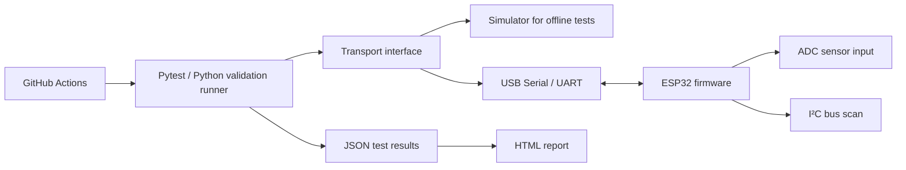

<div align="center">

# Embedded Firmware & Peripheral Validation System

### Validate the firmware. Verify the interface. Automate the evidence.

A portfolio project demonstrating **ESP32 firmware development**, **UART protocol validation**, **Python test automation**, and **CI-ready reporting**.

<p>
  
  
  
  
  
</p>

**Built by [Manjunath G. L.](https://github.com/ManjunathGlO)** · [LinkedIn](https://www.linkedin.com/in/manjunathgl/)

</div>

---

## Project at a glance

This project combines ESP32 firmware with a Python validation harness to exercise a simple device command interface, check responses, and produce test evidence. It is designed to demonstrate a practical workflow used in embedded development and validation: **send a command → capture a response → assert expected behavior → report the result**.

| Area | What this project demonstrates |
|---|---|
| Firmware | ESP32 C++ command handler, ADC reading, device status |
| Device communication | Line-based UART protocol with JSON responses |
| Peripheral checks | I²C bus scan on configured pins |
| Test automation | Python, Pytest, serial transport, simulator |
| Reporting | Pytest JSON output and generated HTML summary |
| Continuous integration | GitHub Actions for host-side automated tests |

> **Scope transparency:** The simulator-backed tests run without a physical board. Real UART/ADC/I²C validation requires an ESP32 and suitable wiring. SPI hardware transactions are a documented future extension, not a completed test in this version.

## Why this project matters

Embedded teams need more than firmware that compiles. They need repeatable ways to verify behavior, diagnose failures, and share clear evidence with developers and test engineers.

This project demonstrates the ability to:

- Define a simple, scriptable device command protocol.
- Validate positive and negative response paths.
- Separate the test logic from the transport layer.
- Use simulation for fast, repeatable host-side checks.
- Produce reports that make test outcomes easy to review.
- Run regression checks automatically through GitHub Actions.

## System architecture



## Validation capabilities

| Check | Command | Expected behavior |
|---|---|---|
| Communication smoke test | `PING` | Returns `PONG` |
| Firmware identification | `VERSION` | Returns firmware name and version |
| Device state | `STATUS` | Returns ready state and uptime |
| ADC sensor read | `READ` | Returns raw ADC value in the expected range |
| I²C discovery | `I2C_SCAN` | Returns a JSON list of detected addresses |
| Negative-path handling | Unknown command | Returns a structured error |
| Response parsing | JSON parser | Rejects malformed or incorrectly shaped responses |

### Example protocol exchange

Request:

```text
PING
```

Response:

```json
{"ok":true,"command":"PING","message":"PONG"}
```

The protocol uses newline-terminated ASCII commands at **115200 baud** and one JSON response per command. The firmware also supports `HELP`.

## Tech stack

<p>
  
  
  
  
  
  
</p>

- **Firmware:** C++, ESP32 Arduino framework, PlatformIO
- **Automation:** Python, Pytest, pySerial
- **Data format:** JSON over UART
- **CI:** GitHub Actions
- **Reports:** pytest-json-report, generated HTML

## Repository structure

```text
embedded-firmware-peripheral-validation/
├── .github/
│   └── workflows/
│       └── tests.yml
├── firmware/
│   └── esp32_validation/
│       ├── platformio.ini
│       └── src/
│           └── main.cpp
├── src/
│   └── embedded_validation/
│       ├── __init__.py
│       ├── protocol.py
│       ├── transport.py
│       └── runner.py
├── tests/
│   ├── conftest.py
│   └── test_validation.py
├── scripts/
│   └── make_html_report.py
├── reports/
├── requirements.txt
├── pytest.ini
├── run_tests.py
└── README.md
```

## Quick start: run tests without hardware

**Requirements:** Python 3.10 or later.

### 1. Clone the repository

```bash
git clone https://github.com/ManjunathGlO/embedded-firmware-peripheral-validation.git
cd embedded-firmware-peripheral-validation
```

If you have not published the repository yet, create it on GitHub with this name and then use the clone URL shown by GitHub.

### 2. Create and activate a virtual environment

**Windows PowerShell**

```powershell
python -m venv .venv
.\.venv\Scripts\Activate.ps1
```

**Linux / macOS**

```bash
python3 -m venv .venv
source .venv/bin/activate
```

### 3. Install dependencies and run the suite

```bash
python -m pip install -r requirements.txt
python run_tests.py
```

The runner executes the simulator-backed Pytest suite. When tests pass, it creates a JSON report and an HTML summary in `reports/`.

To run Pytest directly:

```bash
pytest
```

## Run validation against a physical ESP32

### 1. Build and upload firmware

Install PlatformIO, connect a compatible ESP32 development board, and run:

```bash
cd firmware/esp32_validation
pio run
pio run --target upload
pio device monitor --baud 115200
```

Close the serial monitor before running the Python validator, because the same serial port generally cannot be used by two programs simultaneously.

### 2. Run the Python validation runner

Return to the repository root, activate your virtual environment, and run:

**Windows**

```powershell
$env:PYTHONPATH = "src"
python -m embedded_validation.runner --port COM5 --baud 115200
```

**Linux**

```bash
export PYTHONPATH=src
python -m embedded_validation.runner --port /dev/ttyUSB0 --baud 115200
```

Replace the example port with the one assigned to your board. The runner checks `PING`, `VERSION`, `STATUS`, `READ`, and `I2C_SCAN`, then prints a pass/fail summary.

### Hardware notes

- The example ADC input is **GPIO34**.
- Default I²C pins are **SDA GPIO21** and **SCL GPIO22**.
- Connect compatible peripherals with a common ground and appropriate voltage levels.
- Never apply 5 V directly to an ESP32 GPIO; verify your specific board's electrical limits.
- An empty I²C scan can simply mean no compatible device is connected.
- SPI validation needs a connected SPI peripheral or a loopback fixture and a dedicated transaction test.

## Test reports and CI

Running `python run_tests.py` generates:

- `reports/pytest-report.json` — machine-readable test outcomes.
- `reports/validation-report.html` — compact HTML summary for review.

GitHub Actions runs the host-side test suite on pushes and pull requests to `main` or `master`, and allows manual runs. The report directory is uploaded as a workflow artifact.

**CI limitation:** Hosted GitHub runners do not have this project's physical ESP32 connected. The workflow therefore validates the simulator-backed host tests, not hardware-in-the-loop behavior.

## Engineering practices demonstrated

- **Layered design:** protocol parsing, transport, and test assertions are kept separate.
- **Negative testing:** malformed responses and unknown commands are checked.
- **Repeatability:** simulator enables tests to run without a device attached.
- **Observability:** structured JSON responses and generated test reports.
- **Automation:** regression checks run through CI.
- **Honest validation scope:** simulation results are not represented as physical-hardware results.

## Roadmap

- [ ] Add SPI loopback or peripheral-specific register tests.
- [ ] Add configurable sensor thresholds and calibration checks.
- [ ] Add serial log capture with timestamps and CSV export.
- [ ] Add timeout, disconnect, and malformed-device-response fault injection.
- [ ] Add hardware-in-the-loop execution on a self-hosted runner connected to an ESP32.
- [ ] Add peripheral-specific I²C register read/write tests.

## About the author

I'm building practical projects across embedded systems, validation, and test automation, with a focus on making device behavior measurable and repeatable.

- **GitHub:** [ManjunathGlO](https://github.com/ManjunathGlO)
- **LinkedIn:** [Connect with me](https://www.linkedin.com/in/manjunathgl/)

If you're working on embedded firmware, device validation, or automated testing, I'd welcome feedback and discussion.

---

<div align="center">

**Embedded Firmware · Peripheral Validation · Python Test Automation**

</div>
